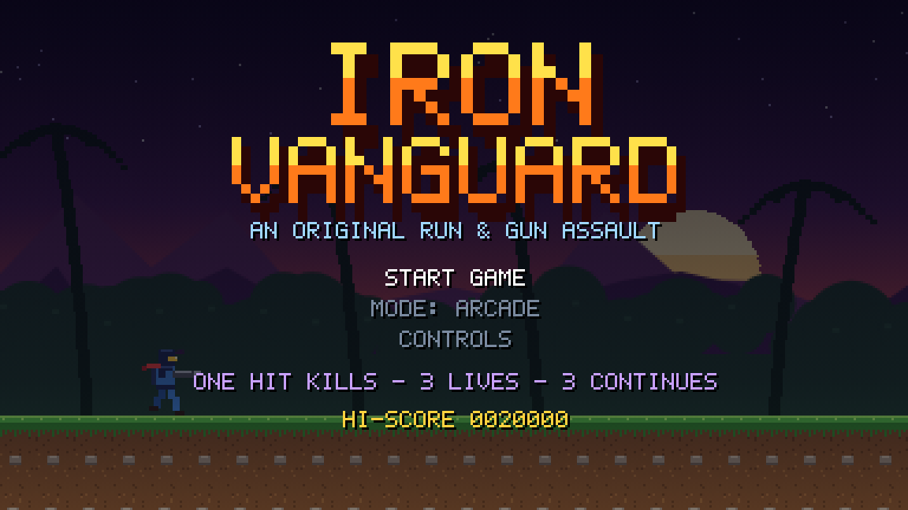
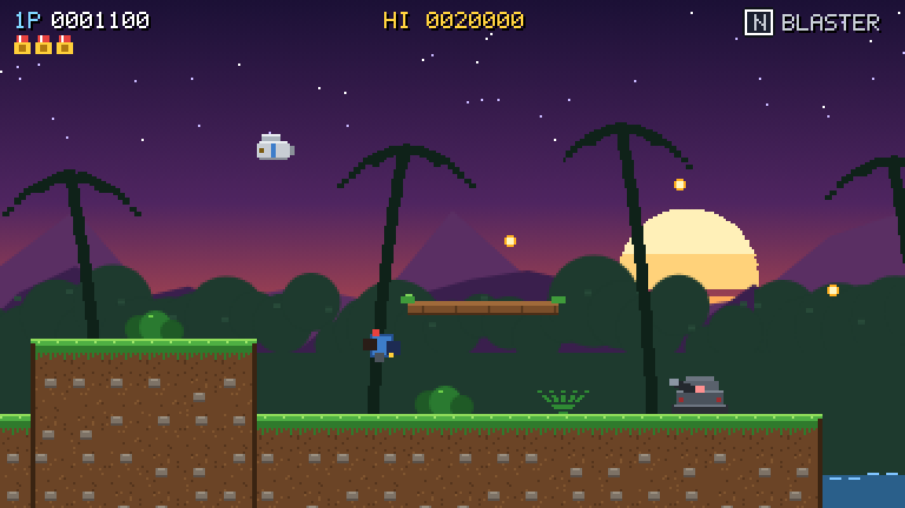
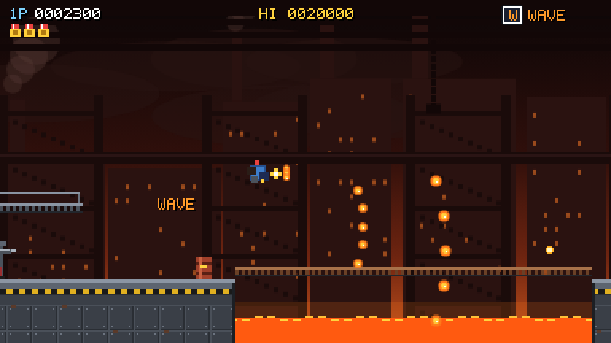
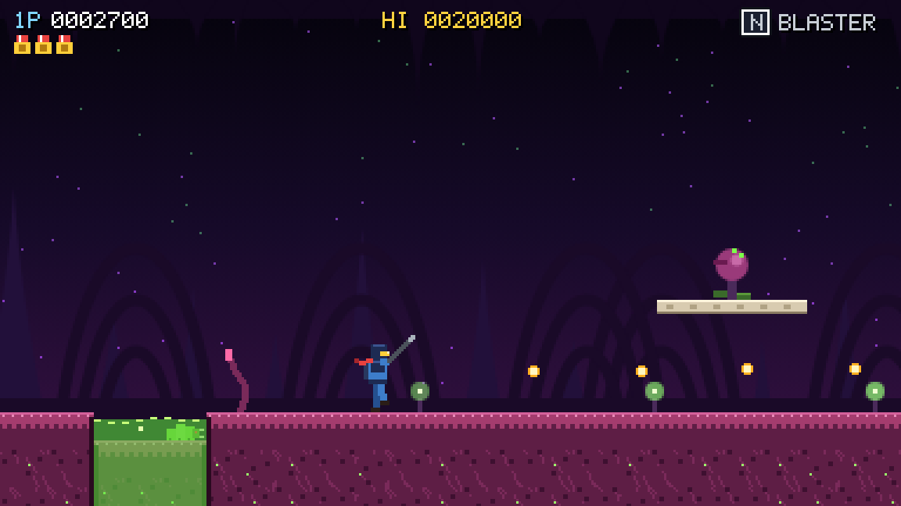
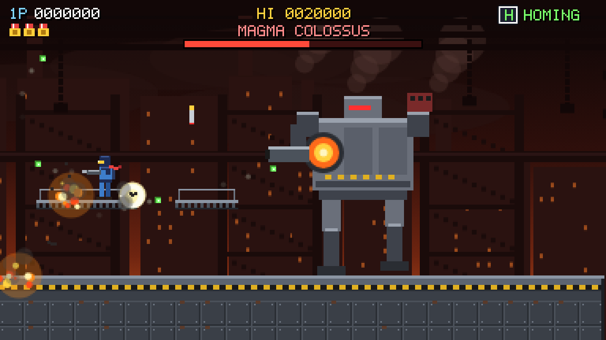

# Iron Vanguard

[](https://github.com/iakashkanaujiya/iron-vanguard/actions/workflows/deploy.yml)

An original run-and-gun action game in TypeScript and HTML5 Canvas. All art is drawn in code and all sound effects and music are synthesized with Web Audio, so there are no assets and no runtime dependencies.

**[Play it in your browser](https://iakashkanaujiya.github.io/iron-vanguard/)**



| | |
| --- | --- |
|  |  |
|  |  |

You play Kade, a Vanguard commando, fighting the Crimson Legion across three stages:

| Stage | Setting | Boss |
| --- | --- | --- |
| 1. Verdant Front | Jungle with collapsing bridges and a wading river | Stormhawk Gunship |
| 2. Iron Foundry | Lava pits, flame vents, moving lifts, crumbling catwalks | Magma Colossus (hit its chest reactor) |
| 3. The Hive | Acid pools, egg sacs, leapers, spitter plants | Hive Matriarch (destroy both maws, then the eye) |

## Running

```bash
npm install
npm run dev        # starts a dev server and opens the game
npm run build      # type-checks and builds to dist/
npm run preview    # serves the production build
```

## Controls

| Action | Keyboard | Gamepad |
| --- | --- | --- |
| Move / aim (8 directions) | Arrows or WASD | D-pad / left stick |
| Jump | Z, K or Space | A |
| Fire (hold for auto) | X or J | X / B / RB |
| Prone | Down | Down |
| Drop through a ledge | Down + Jump | Down + A |
| Pause | Enter, P or Esc | Start |
| Sound on/off | M | Back |

On touch devices an on-screen stick and buttons appear automatically.

Low enemies such as hive crawlers sit under your standing shots, so go prone or aim diagonally down to hit them.

## Power-ups

Shoot the flying supply pods, or the armoured crates while their shutters are open, to release power-ups.

- **R: Rapid**, fast stream of shots
- **W: Wave**, five-way spread
- **L: Lance**, piercing beam that does heavy damage
- **H: Homing**, missiles that seek targets
- **S: Shield**, about 10 seconds of invulnerability (enemies you touch are destroyed)

Dying resets your weapon to the Blaster. You earn an extra life every 30,000 points.

## Modes

- **Arcade:** one hit kills, 3 lives, 3 continues.
- **Casual:** 3 hits per life, 5 lives, unlimited continues, slower enemy bullets.

## Debug URL flags

Add these to the URL, for example `http://localhost:5173/?stage=2&boss`:

- `?stage=N` starts at stage N (1–3)
- `?boss` starts in the boss arena
- `?god` makes you invulnerable
- `?bot` lets the game play itself
- `?ff=N` fast-forwards N frames at startup

## Project layout

```
src/
  main.ts      bootstrap, scaling, fixed-timestep loop
  game.ts      state machine, camera, spawning, collisions, HUD and screens
  entities.ts  player, weapons, projectiles, enemies, pickups, particles
  bosses.ts    the three bosses
  levels.ts    level builder and stage layouts
  physics.ts   platformer collision (solids and one-way platforms)
  art.ts       bitmap font, sprite rigs, tiles, parallax backdrops
  audio.ts     synthesized sound effects and the music sequencer
  core.ts      constants, helpers, input (keyboard, gamepad, touch)
  types.ts     shared types
```
